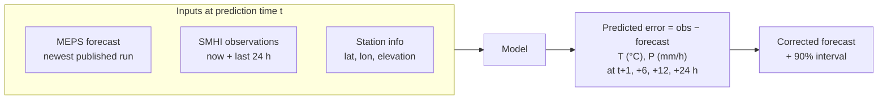
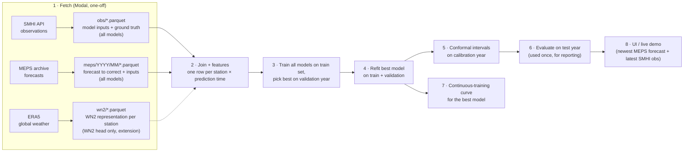
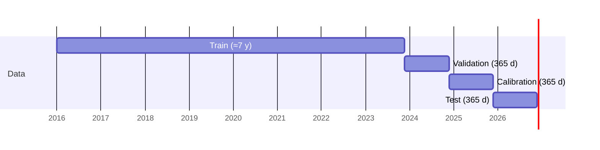
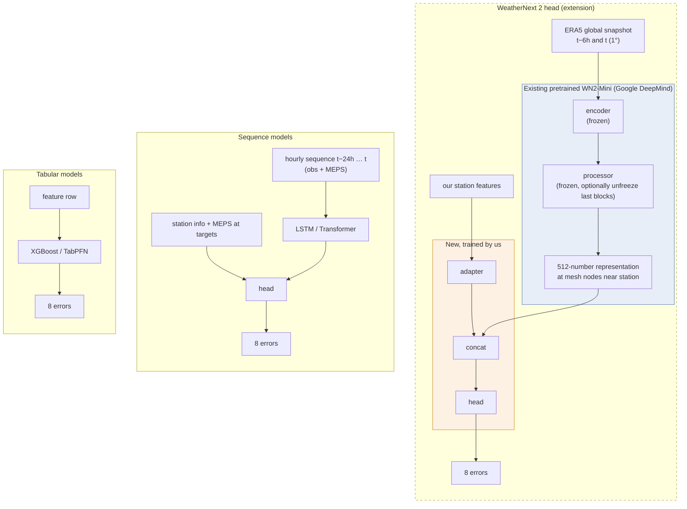
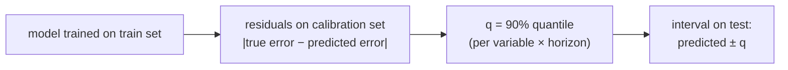

# Project plan — Group 20

Detailed plan built on [project-proposal.md](project-proposal.md), updated after exploring the data sources
(2026-11-23).

## Decision log

| decision | choice | why |
|---|---|---|
| Forecast source | MEPS (MET Norway THREDDS archive) | SMHI's own model, 10 years of history, 2.5 km, hourly; full history can be downloaded in ~2.5 days; live feed in the same format |
| Which forecast run to use | the newest run that was already *published* at prediction time | matches live use; no access to forecasts that wouldn't exist yet |
| Precipitation metrics | mm/h error + wet-hours-only metrics + rain/no-rain hit rate | hourly precipitation is mostly 0, so a model that always predicts "no rain" already gets a low mm/h error; wet-hours metrics and hit rate show whether it gets the rainy hours right |
| TabPFN | one context per station (~70k rows, every hour of all years) | TabPFN accepts at most 1M rows; the full training set is ~10M rows per horizon (142 stations × ~70k hours). Larger per-region contexts (~0.9M rows) were dropped to limit compute |
| Observation history | last 24 h for all models (the proposal allowed 24 or 72 h) | older hours probably add little (weather 2-3 days ago is mostly unrelated to the next hours), while 72 h would ~3× TabPFN compute |
| TabPFN model size | TabPFN-3.5-Fast instead of TabPFN-3.5 | ~3-4× less compute (est. ~7 h instead of ~25 h); Fast is Prior Labs' smaller checkpoint (84M vs 220M parameters) and may be slightly less accurate |
| Split | train 2016 → 2023-11, validation 2023-11 → 2024-11, calibration and test as in the proposal; the best model is refit on train + validation | the proposal had no validation set, so the model would have been chosen on the test year (optimistic results) or the calibration year (biased intervals); refitting keeps the final model close to today |
| Continuous training | only for the best model: first compare all models on the validation year, then run the yearly-checkpoint curve on the winner | the curve per model is expensive (×9 trainings; TabPFN ×9 full test-year predictions); it is only needed for the model we would deploy |
| WeatherNext 2 | frozen pretrained backbone + new head, as an extension | the only sensible transfer design; highest effort and risk |

---

## 1. Problem



8 outputs per sample: {temperature, precipitation} × {+1, +6, +12, +24 h}.

A *forecast run* is one forecast computed by the weather model, started at a fixed time (e.g. "the 06:00 run") and
covering the next hours.

---

## 2. Pipeline overview



All steps are first developed locally on a small subset; only full runs go to Modal.

---

## 3. Data sources

| | **MEPS** via MET Norway ✅ chosen | ECMWF open data on AWS | Open-Meteo Single Runs API | Open-Meteo Historical Forecast API |
|---|---|---|---|---|
| Forecast model | MetCoOp MEPS — **SMHI's own operational model** | ECMWF IFS | ECMWF IFS | ECMWF IFS |
| Grid resolution (smaller = more local detail) | **2.5 km** | ~28 km (0.25°) | 9 km | 9 km |
| Archived forecast runs available from | **2016 (~10 years)** | 2023-01 (~3.8 years) | 2024-03 (~2.7 years) | 2017 (~10 years) |
| Time between forecast steps | **1 hour** | 3 hours | **1 hour** | 1 hour |
| Has forecasts made ≥ 24 h before the target time (needed for our +24 h horizon) | ✅ yes, up to 66 h | ✅ yes, up to 144 h | ✅ yes, up to 90 h | ❌ no, only 0-11 h |
| Estimated time to download the full history for 30 stations | ~1-1.5 days | a few hours | ~7 days (rate limit 10k calls/day) | < 1 day |

MEPS is the only source in the table that combines SMHI's own model, the finest grid, hourly steps, ~10 years of
history and forecasts made ≥ 24 h ahead.

---

## 4. The data

- **Period:** 2016 → 2026-11 (all of MEPS's archive; this means handling 3 different file layouts).
- **Stations:** all 142 SMHI stations with both hourly temperature and precipitation. Downloading costs the same per
  forecast run regardless of the number of stations, so we take all of them.

### 4.1 SMHI observations (ground truth + inputs)

`https://opendata-download-metobs.smhi.se/api/version/1.0/parameter/{param}/station/{id}/period/{period}/data.csv`

- **Station set:** the 142 active stations with both hourly temperature (param 1) and hourly precipitation sum
  (param 7), spanning 55.4–68.7 °N. Extra inputs where available: humidity (6), sea-level pressure (9), wind (4, 3).
- **Periods:** `corrected-archive` is quality-controlled and ends ~3 months ago; `latest-months` covers the last ~4
  months unchecked. The end of the test year therefore uses unchecked data (quality flag kept).
- Stations can move; the CSV header lists positions per period.

```
Datum;Tid (UTC);Nederbördsmängd;Kvalitet        (date; time; precipitation mm; quality G = checked, Y = suspect)
2025-08-15;21:00:00;0.3;G
2025-08-15;22:00:00;0.6;G
```

### 4.2 MEPS forecasts (MET Norway THREDDS)

Archive `https://thredds.met.no/thredds/dodsC/meps25epsarchive/YYYY/MM/DD/<file>`, live
`https://thredds.met.no/thredds/dodsC/mepslatest/<file>` (OPeNDAP).

- **Runs:** started at 00:00, 06:00, 12:00, 18:00 UTC, each forecasting 0-66 h ahead in hourly steps, published
  ≈ 2.5 h after the start time. Live has a run every 3 h; we use only the same 4 start times as the archive.
- **Variables:** 2 m temperature, accumulated precipitation (differenced to hourly), humidity, sea-level pressure,
  10 m wind, cloud cover, shortwave radiation.
- **File layouts:** `meps_mbr0_extracted_backup_2_5km_*.nc` (2016 → mid-2020, different variable names),
  `meps_det_2_5km_*.nc` (→ 2023), `meps_det_sfc_*.ncml` (2024 →).
- **Fetching:** asking the server for single points is slow (~10 s per station per run) because it reads whole map
  fields from disk regardless of how little we request. Instead we download one Sweden-sized box per run (needed
  variables, first 36 h of the forecast) and cut out the station cells ourselves — ~2.5 days for 2016 → on Modal, newest first,
  so the test and calibration years arrive within ~half a day. Storage after extraction: ~1 GB parquet.

**Real example** — Stockholm-Observatoriekullen (98230), MEPS forecast started 2025-08-14 18:00 UTC vs SMHI observations:

```
target time (UTC)  hours since forecast start  T_fc  T_obs  err_T │ P_fc  P_obs  err_P
2025-08-15 17:00                          23h  23.3   23.5   +0.2 │  0.0   0.0   +0.0
2025-08-15 18:00                          24h  22.7   22.7   -0.0 │  0.0   0.0   +0.0
2025-08-15 19:00                          25h  21.2   21.9   +0.7 │  3.3   0.0   -3.3   ← shower forecast, didn't happen
2025-08-15 20:00                          26h  21.9   14.7   -7.2 │  0.0   0.0   -0.0   ← cool air arrived 1 h earlier than forecast
2025-08-15 21:00                          27h  18.3   13.1   -5.2 │  0.1   0.3   +0.2
2025-08-15 22:00                          28h  15.2   12.9   -2.3 │  0.2   0.6   +0.3
```

Timing errors around fronts and showers like these are what the models should learn to predict.

---

## 5. Problem definition: prediction time, latency, targets

At the hour we make our prediction (the *prediction time*, *t*), we only use the **newest forecast run that has already
been published**, exactly as a live system would.

```
prediction time t = 14:00 UTC

forecast started 06:00 ── published ~08:30 ✓  ← newest available, use this
forecast started 12:00 ── published ~14:30 ✗  not out yet at 14:00

horizon   target time    hours since forecast start (target − 06:00)
 +1 h       15:00           9 h
 +6 h       20:00          14 h
+12 h       02:00          20 h
+24 h       14:00 (+1d)    32 h

observations up to 14:00 are available as input
```

The "+1 h" model therefore corrects a forecast made 4-9 h before the target (depending on the hour), but has observations
from 1 h before it. This makes the task harder than using a fresh forecast, but it is exactly what a live system would face.

**Sample** = one station at one prediction time; we make a prediction every hour → ~142 × 70k ≈ 10M training rows per horizon.
**Targets** = `err_T = T_obs − T_fc` (°C) and `err_P = P_obs − P_fc` (mm/h) at the 4 horizons.

| feature group | examples |
|---|---|
| MEPS at target time | T, P, humidity, pressure, wind u/v, cloud, radiation at the target hour (±1 h) |
| MEPS context | hours since forecast start, how wrong the run's forecast is *right now* (forecast for *t* vs obs at *t*) |
| observations | T, P, humidity, pressure, wind at *t* and each of the previous 24 h |
| station | lat, lon, station elevation, MEPS grid-cell elevation − station elevation |
| time | hour of day, day of year (sin/cos) |

---

## 6. Splits and continuous training



Two steps:

1. **Model comparison:** every model is trained on the training set (2016 → 2023-11); early stopping, tuning and the
   choice of best model use the validation year. The best model is then refit on train + validation (2016 → 2024-11),
   so it has seen the most recent data, calibrated, and evaluated on the test year. All models are reported on the
   test year, but the test year is never used to choose between them.
2. **Continuous training (best model only):** the winner of step 1, the model we would deploy, gets the yearly
   checkpoint curve below.

**Why step 2:** the deployed system must be retrained regularly to stay up to date (project requirement). We simulate the
effect of these regular updates offline with an expanding training window: the model is trained in time order, a
checkpoint is saved after each added year of data (as if the deployed model had been retrained then), and every
checkpoint is evaluated on the same recent test year (2025-11 → 2026-11). The curve shows how much each additional, more recent year of data improves the model.

```
checkpoint  ≈ deployed model retrained at end of   trained on        test MAE (example shape)
2016        2016                                   2016              │██████████
2017        2017                                   2016-17           │█████████
2018        2018                                   2016-18           │████████
 ...                                                                 │ ...
2024        2024-11                                2016 → 2024-11    │██████
```

How a yearly update is done, depending on which model wins:

| model | how a yearly update is done |
|---|---|
| XGBoost | continue boosting with the new year's data |
| LSTM / Transformer | warm start from the previous checkpoint, train on the new year |
| TabPFN | add the new year to each station's context |

---

## 7. Models

| model | input | notes |
|---|---|---|
| Raw MEPS | — | predicts 0 error; reference |
| Rolling bias | last 30 days' error per station × horizon × hour of day | baseline |
| XGBoost | tabular features | one model per output (8) |
| TabPFN-3.5-Fast | tabular features | one context per station, ~70k rows; GPU; research license |
| LSTM | hourly sequence of last 24 h (obs + MEPS) + station info | 8 outputs |
| Transformer | same sequences | 8 outputs |
| WeatherNext 2 head | WN2 latents near station + tabular features | **extension**, see below |



### WeatherNext 2 head (extension)

Done **after** all other models. WN2 is Google DeepMind's global AI weather model. It takes a snapshot of the whole
atmosphere and builds an internal representation of the weather situation. We keep its pretrained layers frozen, take
that representation near each station, and train a new head on it (plus our own features) to predict MEPS's error.

Architecture: dashed box in the diagram above.

Input data: **ERA5** (ECMWF's reconstruction of past global weather, free on Google Cloud, up to ~1 week ago) for
training and testing; **HRES analysis** (ECMWF's real-time snapshot, free on AWS) for live use.

Weights, input format and ERA5 availability are confirmed. Open issues:

| issue | impact |
|---|---|
| Loading the JAX model on Modal and extracting the internal representation is untested | first task of the extension; go / no-go point |
| Fine-tuning (unfreezing) needs an H100; a smaller GPU only fits inference | frozen backbone by default |
| ~4 TB of ERA5 must be *read* (~0.5 GB per snapshot, 12-hourly 2016 → 2026); nothing large is *stored* | stream each snapshot from Google Cloud into the GPU job, keep only the representation at the stations (~1-5 GB total), discard the input; to read less, use Google's 1° ERA5 copy for ≤ 2022 or fewer years |
| Trained on ERA5, live input is HRES | small mismatch between training and live data |

### Training runs and compute

Data sizes: training set ~10M rows (142 stations × ~70k hours), calibration and test sets ~1.2M rows each
(142 × 8,760 hours). One *fit* = one model trained (or, for TabPFN, one context loaded) and used to predict the
calibration and test sets.

| model | fits in step 1 (comparison) | rows per fit | hardware | estimated time, step 1 |
|---|---|---|---|---|
| Raw MEPS, rolling bias | 0 | — | laptop | seconds |
| XGBoost | 8 (one per output) | ~10M | CPU (many cores) or 1 GPU | ~1-4 h total |
| LSTM | 1 (8 outputs) | ~10M sequences of 24 h | 1 GPU (A10G / A100) | ~1-3 h |
| Transformer | 1 (8 outputs) | ~10M sequences of 24 h | 1 GPU (A100) | ~1-3 h |
| TabPFN-3.5-Fast (per station) | 1,136 (142 stations × 8 outputs) | ~70k context, ~17k predicted | 1 GPU (24-48 GB, e.g. L40S) | ~20 s per fit ≈ 7 h total |
| WN2 head (extension) | 1 head + ~7.7k frozen forward passes for the internal representation | ~10M | 1 GPU; ~4 TB ERA5 streamed (not stored) | dominated by ERA5 reading; ~0.5-1 day |

Step 2 (continuous training) multiplies only the winning model's row by 9 checkpoints with growing training data
(≈ 4-5× the step-1 time in total, since early checkpoints are small).

Times are rough estimates, not measurements.

**Estimated Modal cost** for one pass (MEPS fetch, all models, step 2; Modal list prices, 2026-11): ~$40-125 without
the WN2 extension, ~$70-205 with it.
Code is developed and debugged locally on a small subset (~1 month, ~10 stations), so Modal is used only for full runs.

---

## 8. Uncertainty and evaluation

**Split conformal prediction** on the calibration year, one interval per variable × horizon:



| metric | computed on |
|---|---|
| MAE, RMSE | all hours, per variable × horizon |
| MAE, RMSE on wet hours | precipitation, hours where P_obs > 0.1 or P_fc > 0.1 mm |
| rain / no-rain hit rate | precipitation |
| coverage and mean width | 90% intervals |

Main figures:
1. MAE per horizon, all models vs raw MEPS (grouped bars, T and P).
2. Test MAE vs years of training data for the best model (continuous-training curve, §6).
3. One station-week: MEPS forecast, corrected forecast with interval band, observations.
4. Map of per-station MAE improvement.
